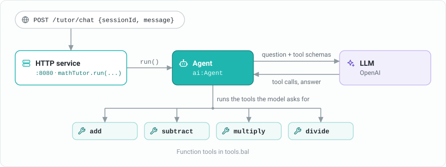

## How it works

An agent is a loop around a model. The model reads the student's question and the descriptions of the available tools, and either asks for a tool call or returns the final answer. The agent runs the requested tools, sends their results back to the model, and repeats until the model answers.



Language models are good at explaining but unreliable at exact arithmetic. The tutor lets the model do the explaining and hands every calculation to a Ballerina function, so the numbers in the answer are always correct.

## Set up the prerequisites

To complete this guide, you need:

1. Ballerina 2201.13.0 (Swan Lake Update 13) or later. Install [Ballerina](/downloads/), or use the `bal dist pull` command to update an existing installation.

    ```
    $ bal dist pull 2201.13.0
    ```

2. An OpenAI API key. To use a different provider, see [Use a different model provider](#use-a-different-model-provider).

3. A text editor.

    >**Tip:** Preferably, <a href="https://code.visualstudio.com/" target="_blank">Visual Studio Code</a> with the <a href="https://wso2.com/ballerina/vscode/docs/" target="_blank">Ballerina extension</a> installed.

4. A command terminal.

## Create the package

In the terminal, execute the command below to create a package.

```
$ bal new math_tutor
```

Remove the automatically-created `main.bal` file. By the end of this guide, the package contains the files below.

```
.
├── math_tutor
│   ├── Ballerina.toml
│   ├── Config.toml
│   ├── agent.bal
│   ├── service.bal
│   └── tools.bal
```

## Define the tools

A tool is an `isolated` function annotated with `@ai:AgentTool`. The agent builds the tool's description for the model from the function's name, parameter types, and documentation comment, so the documentation tells the model what the tool does and when to use it.

Add the following to `tools.bal`.

```ballerina
import ballerina/ai;

# Adds two numbers.
#
# + a - The first number
# + b - The second number
# + return - The sum of the two numbers
@ai:AgentTool
isolated function add(decimal a, decimal b) returns decimal => a + b;

# Subtracts the second number from the first.
#
# + a - The number to subtract from
# + b - The number to subtract
# + return - The difference of the two numbers
@ai:AgentTool
isolated function subtract(decimal a, decimal b) returns decimal => a - b;

# Multiplies two numbers.
#
# + a - The first number
# + b - The second number
# + return - The product of the two numbers
@ai:AgentTool
isolated function multiply(decimal a, decimal b) returns decimal => a * b;

# Divides the first number by the second.
#
# + a - The dividend
# + b - The divisor, which must not be zero
# + return - The quotient, or an error if the divisor is zero
@ai:AgentTool
isolated function divide(decimal a, decimal b) returns decimal|error {
    if b == 0d {
        return error("Cannot divide by zero.");
    }
    return a / b;
}
```

The tools use `decimal`, so results such as `0.1 + 0.2` are exact. When `divide` returns an error, the agent sends the error to the model as the tool result, and the tutor explains the problem to the student instead of failing.

## Define the agent

Add the following to `agent.bal`. It creates the model provider and the agent, with a system prompt and the four tools.

```ballerina
import ballerina/ai;
import ballerinax/ai.openai;

configurable string openAiApiKey = ?;

final ai:ModelProvider model = check new openai:ModelProvider(openAiApiKey, openai:GPT_4O);

final ai:Agent mathTutor = check new (
    systemPrompt = {
        role: "Math Tutor",
        instructions: string `You help students understand arithmetic.

            Rules:
            - Use the tools for every calculation. Never compute a result yourself.
            - Explain each step in plain language, then give the final answer.
            - If a calculation fails, explain why to the student.
            - Do not answer questions that are not about math.`
    },
    model = model,
    tools = [add, subtract, multiply, divide]
);
```

- `systemPrompt` sets the agent's `role` and the `instructions` it follows on every request.
- `tools` lists the functions that the model can ask the agent to call.
- The agent keeps a short-term memory of each conversation by default, keyed by the session ID passed to `run`. A student can ask a follow-up question without repeating the numbers.

Create a `Config.toml` file in the package root and add your key.

```toml
openAiApiKey = "<YOUR_OPENAI_API_KEY>"
```

### Use a different model provider

The agent depends only on the `ai:ModelProvider` type. To switch providers, change the import and the line that creates `model`, for example to [`ballerinax/ai.anthropic`](https://central.ballerina.io/ballerinax/ai.anthropic/latest) or [`ballerinax/ai.azure`](https://central.ballerina.io/ballerinax/ai.azure/latest). Choose a model that supports tool calling. The tools and the agent stay the same.

## Expose the agent as a chat service

Add the following to `service.bal`. The request and response use the `ai:ChatReqMessage` (`sessionId` and `message`) and `ai:ChatRespMessage` (`message`) types from the `ballerina/ai` module.

```ballerina
import ballerina/ai;
import ballerina/http;

service /tutor on new http:Listener(8080) {
    resource function post chat(ai:ChatReqMessage request) returns ai:ChatRespMessage|error {
        string answer = check mathTutor.run(request.message, request.sessionId);
        return {message: answer};
    }
}
```

`run` executes the agent loop and binds the final answer to `string`.

## Run the agent

Execute the command below to run the package.

```
$ bal run
```

You view the output below.

```
Compiling source
        <org>/math_tutor:0.1.0

Running executable
```

## Chat with the tutor

Send a question with a session ID. Because the replies are generated by an LLM, the ones below are illustrative and your results will differ.

```
$ curl -X POST http://localhost:8080/tutor/chat \
    -H "Content-Type: application/json" \
    -d '{"sessionId": "student-1", "message": "A box holds 12 pencils. How many pencils are in 15 boxes?"}'
{"message":"Each box has 12 pencils, and there are 15 boxes, so we multiply 12 by 15. 12 × 15 = 180. There are 180 pencils in total."}
```

To answer, the agent calls `multiply` with `12` and `15`.

Ask a follow-up question in the same session. The agent remembers the earlier answer.

```
$ curl -X POST http://localhost:8080/tutor/chat \
    -H "Content-Type: application/json" \
    -d '{"sessionId": "student-1", "message": "If we share them equally among 4 students, how many does each get?"}'
{"message":"We have 180 pencils to share among 4 students, so we divide 180 by 4. 180 ÷ 4 = 45. Each student gets 45 pencils."}
```

Ask the tutor to divide by zero. The `divide` tool returns an error, and the tutor explains it.

```
$ curl -X POST http://localhost:8080/tutor/chat \
    -H "Content-Type: application/json" \
    -d '{"sessionId": "student-2", "message": "What is 10 divided by 0?"}'
{"message":"Dividing by zero isn't defined. Division asks which number, multiplied by 0, gives 10, and no number does, so there is no answer."}
```

## Choose your next guide

- [Build an agent that uses enterprise systems](/learn/build-an-agent-that-uses-enterprise-systems/) — Give an agent tools that call real APIs, configure memory, and handle tool failures.
- [Connect integrations and agents through MCP](/learn/connect-integrations-and-agents-through-mcp/) — Expose tools over MCP and use MCP tools from an agent.
- [Evaluate agent behavior](/learn/evaluate-agent-behavior/) — Check that the agent gives the right answers and calls the right tools.

## Learn more

- [AI integrations overview](/learn/ai-integrations-overview/)
- [Agent with local tools](/learn/by-example/ai-agent-local-tools/) — Ballerina by Example
- [Chat agents](/learn/by-example/chat-agents/) — Ballerina by Example
- [`ballerina/ai` module](https://lib.ballerina.io/ballerina/ai/latest/) — API documentation
