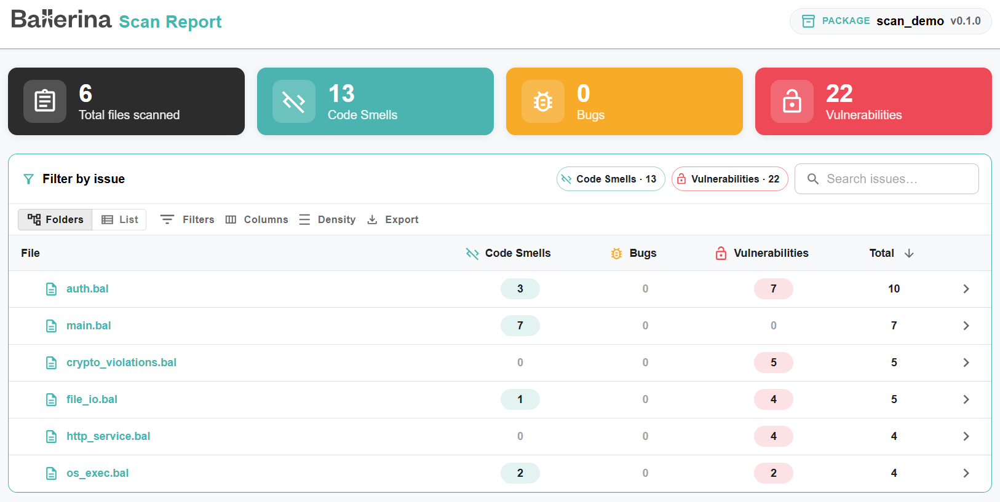
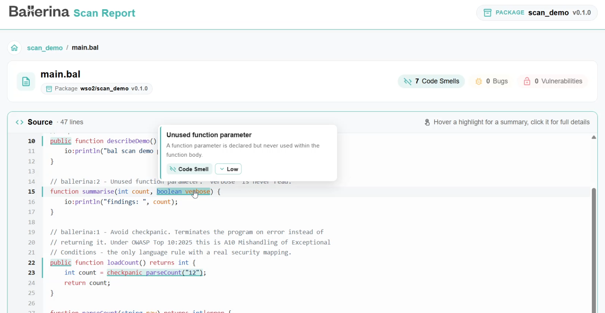
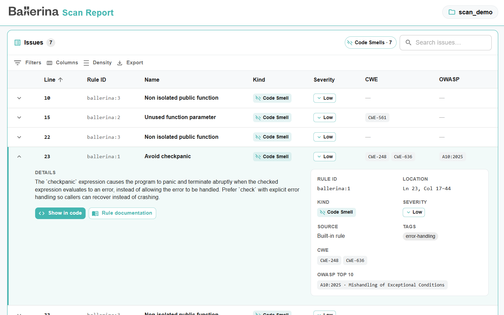

The Ballerina scan tool is a static code analysis tool that performs analysis on Ballerina projects and identifies
potential code smells, bugs, and vulnerabilities without executing them.

> **Note:** Ballerina scan is an experimental feature, and its rule set is small for two separate reasons. The tool itself is still growing, and the language already closes off several weakness classes that other static analysis tools must detect at scan time, because the compiler rejects them outright. See [Language guarantees](/learn/language-guarantees/) for what the compiler enforces.

## Install the tool

Execute the command below to pull the scan tool from [Ballerina Central](https://central.ballerina.io/ballerina/scan/latest).

```
$ bal tool pull scan
```

To verify the installation and check the version:

```
$ bal tool list
```

For more information about managing Ballerina tools, refer to the [Ballerina CLI tool command documentation](https://ballerina.io/learn/cli-commands/#tool-commands).

## Command syntax

The Ballerina scan tool follows this general syntax:

```
$ bal scan [OPTIONS] [<workspace>|<package>|<source-file>]
```

### Arguments

- `<workspace>`: Analyzes each package in the specified workspace in dependency order
- `<package>`: Analyzes all Ballerina files in the specified package (optional, defaults to current directory)
- `<source-file>`: Analyzes a specific standalone Ballerina file (`.bal` extension required)

> **Note:** Analyzing individual Ballerina files that are part of a package is not supported.
> You must analyze the entire package or work with standalone files.

### Available options

All options are optional. Rule filters, platforms, suppression settings, the gate, and test exclusion can also be
configured in a `Scan.toml` file. See [Configure the scan with Scan.toml](#configure-the-scan-with-scantoml).

| Option                                                 | Description                                                                                                                                                          | Default                                  |
|--------------------------------------------------------|----------------------------------------------------------------------------------------------------------------------------------------------------------------------|------------------------------------------|
| `--target-dir=<path>`                                  | Specify target directory for analysis reports (only for Ballerina projects)                                                                                          | The project's `target` directory         |
| `--scan-report`                                        | Generate HTML report with detailed analysis results (only for Ballerina projects)                                                                                    | Disabled                                 |
| `--format=<json\|sarif>`                               | Specify the format of the report                                                                                                                                     | `json`                                   |
| `--list-rules`                                         | List the rules available to the project, along with their kind and severity (only inside a project)                                                                  | Disabled                                 |
| `--include-rules=<rule1, ...>`                         | Run analysis for specific rules only. A rule that is not available to the project is an error                                                                        | All available rules are included         |
| `--exclude-rules=<rule1, ...>`                         | Exclude specific rules from analysis. A rule that is not available to the project is an error                                                                        | No rules are excluded                    |
| `--platforms=<platform1, ...>`                         | Define platforms for result reporting (not supported for a single Ballerina file)                                                                                    | Results are not reported to any platform |
| `--ignore-suppressions`                                | Disregard `@scan:Suppress` annotations and report every issue. See [Suppress issues](#suppress-issues)                                                               | Disabled                                 |
| `--require-suppression-reason`                         | Fail the scan when a `@scan:Suppress` annotation does not give a reason                                                                                              | Disabled                                 |
| `--require-suppression-rule-id`                        | Fail the scan when a `@scan:Suppress` annotation does not name the rules it suppresses                                                                               | Disabled                                 |
| `--fail-on-severity=<BLOCKER\|HIGH\|MEDIUM\|LOW\|INFO\|NONE>` | Fail the scan when the number of issues at or above this severity reaches `--fail-on-count`, or `1` if the count is not set. See [Exit codes and the gate](#exit-codes-and-the-gate) | No gate is set                           |
| `--fail-on-count=<n>`                                  | Fail the scan when there are `n` or more issues at or above `--fail-on-severity`, or of any severity if it is not set                                                | No gate is set                           |
| `--exclude-tests[=<true\|false>]`                      | Leave the test sources of each package out of the scan. Written alone, it means `true`                                                                               | Test sources are scanned                 |

## Running analysis

You can analyze all Ballerina files in the current package by running the following command inside the package
directory:

```
$ bal scan
```

This command will:

- Compile and analyze all `.bal` files in the current package
- Print results to the console
- Save results in JSON format in the `target/scan` directory

If you want to analyze a specific package, you can provide the package name as an argument:

```
$ bal scan mypackage
```

If you want to analyze a specific standalone Ballerina file, you can provide the file name as an argument:

```
$ bal scan myfile.bal
```

When run on a workspace, the scan tool resolves the workspace dependencies and analyzes each package in dependency
order. The issues of every package are printed as one document.

### Console output

Only the issues are written to standard output, so `bal scan > issues.json` saves valid JSON, or SARIF with
`--format=sarif`. Progress messages, warnings, report paths, and the closing summary, such as `3 issue(s)`, are written
to standard error.

### Dependency resolution

The scan uses the dependency versions locked in `Dependencies.toml`, as `bal build --locking-mode=hard` does. A package
without `Dependencies.toml` is not scanned, in the command line or the editor, and its rules are not listed either. Run
`bal build` first to lock its dependencies. The scan does not update `Dependencies.toml`.
Only the analyzers declared in `Scan.toml` are resolved by the scan, since they are not dependencies of the package. In
a workspace, each package needs its own `Dependencies.toml`.

## Report generation

To generate a detailed HTML report of the analysis results, use the `--scan-report` option:

```
$ bal scan --scan-report
```

This will produce an HTML report and scan results in JSON format inside the `target/report` directory (or the directory
given via `--target-dir`). The report is only generated for Ballerina projects, not for standalone Ballerina files. It
is generated even when the results are also reported to a platform.

The HTML report includes a summary of the total number of files scanned and the number of code smells, bugs, and
vulnerabilities found in each file. You can filter, search, and export the list of files.



To investigate further, you can click on a file name to open the file view. This view shows the source of the file and
highlights the exact lines where problems were detected. Hover over a highlight to see a summary of the issue, or click
it to see the full details.



The issues found in the file are listed in a table with the line, rule ID, name, kind, severity, CWE, and OWASP Top 10
category of each issue. Expand an issue to see its description and the full rule details, such as its location, source,
and tags. From there, you can jump to the issue in the source using **Show in code**, or open the rule's documentation
using **Rule documentation**.



## Custom target directory

You can specify a custom target directory for the analysis results using the `--target-dir` option.
This is useful if you want to store the results in a specific location or if you are working with multiple projects.

```
$ bal scan --target-dir="path/to/your/target/directory"
```

## Report formats

By default, the scan tool generates reports in `JSON` format.
However, you can specify the report format using the `--format` option.

The available formats are `json` and `sarif`. The `json` format is the default, while `sarif` is a
standardized format for static analysis results.

In the `json` format, each finding is reported with its location, the details of the rule that raised it, and other
useful information:

```json
[
  {
    "location": {
      "filePath": "main.bal",
      "startLine": 22,
      "endLine": 22,
      "startColumn": 16,
      "endColumn": 43,
      "startOffset": 875,
      "length": 27,
      "snippet": "checkpanic parseCount(\"12\")"
    },
    "rule": {
      "id": "ballerina:1",
      "numericId": 1,
      "name": "Avoid checkpanic",
      "description": "Using `checkpanic` lets an unhandled error panic and crash the program instead of being handled.",
      "details": "The `checkpanic` expression causes the program to panic and terminate abruptly when the checked expression evaluates to an error, instead of allowing the error to be handled. Prefer `check` with explicit error handling so callers can recover instead of crashing.",
      "helpUri": "https://ballerina.io/learn/scan-rules/#ballerina-1",
      "severity": "LOW",
      "tags": [
        "error-handling"
      ],
      "standards": {
        "cwe": [
          248,
          636
        ],
        "owasp": [
          {
            "year": 2025,
            "categories": [
              10
            ]
          }
        ]
      },
      "ruleKind": "CODE_SMELL"
    },
    "source": "BUILT_IN",
    "fileName": "main.bal",
    "filePath": "/home/user/bal-scan-demo/main.bal"
  }
]
```

To generate a report in the `sarif` format, use the following command:

```
$ bal scan --format=sarif
```

## List available rules

To view all available rules for your project, you can use the `--list-rules` option:

```
$ bal scan --list-rules
```

This will display the rules available to your project, along with their kind and severity, which you can include or
exclude in future scans. The list contains the core rules and the rules contributed by the project's dependencies
(library tools and static code analyzer plugins).

The output will look something like this:

```
RuleID       | Rule Kind     | Severity | Rule Description
-------------|---------------|----------|-------------------------------------------------
ballerina:1  | CODE_SMELL    | LOW      | Avoid checkpanic
ballerina:2  | CODE_SMELL    | LOW      | Unused function parameter
...
ballerina:13 | VULNERABILITY | HIGH     | Hard-coded secrets are security-sensitive
ballerina:14 | VULNERABILITY | MEDIUM   | Non configurable secrets are security-sensitive
...
```

> **Note:** The `--list-rules` option only works inside a Ballerina project. The displayed rules are project-specific
> and determined by your project's dependencies.

For detailed explanations of each rule, with noncompliant and compliant code examples, see [Scan rules](/learn/scan-rules/).

## Rule severity

Every rule has a `severity` that indicates how urgently a reported issue should be addressed, and how it can affect
development and deployment if left unresolved:

| Severity  | Meaning                                                                                       | Impact                                                                            |
|-----------|-----------------------------------------------------------------------------------------------|-----------------------------------------------------------------------------------|
| `BLOCKER` | A critical issue that is very likely to cause application failure or a security breach.       | Should block merging or deployment until fixed.                                   |
| `HIGH`    | A serious issue likely to cause incorrect behavior or expose the application to exploitation. | Should be fixed before deployment.                                                |
| `MEDIUM`  | An issue that affects reliability, maintainability, or security to a moderate degree.         | Should be scheduled and fixed soon, does not need to block deployment on its own. |
| `LOW`     | A minor issue such as a code smell that affects readability or maintainability.               | Safe to defer, but worth cleaning up over time.                                   |
| `INFO`    | An informational finding with no material severity.                                           | Does not require action; useful for awareness.                                    |

Where applicable, a rule is also mapped to its relevant CWE and OWASP Top 10 coverage. See
[Security standards mapping](/learn/scan-rules/#security-standards-mapping).

## Include specific rules

You can run the analysis for specific rules by using the `--include-rules` option.
This allows you to focus on particular areas of your codebase that you want to analyze.

```
$ bal scan --include-rules="ballerina:1"
```

You can also include multiple rules by listing them as a comma-separated string:

```
$ bal scan --include-rules="ballerina:1, ballerina/io:2"
```

## Exclude specific rules

You can exclude specific rules from the analysis using the `--exclude-rules` option.
This is useful if you want to ignore certain rules that are not relevant to your project or if you have already
addressed them.

```
$ bal scan --exclude-rules="ballerina:1"
```

To exclude multiple rules, provide them as a comma-separated list:

```
$ bal scan --exclude-rules="ballerina:1, ballerina/io:2"
```

> **Note:** A rule ID that is not available to the project is an error, for both `--include-rules` and
> `--exclude-rules`. To accept a single issue rather than turning a rule off for the whole project, see
> [Suppress issues](#suppress-issues).

## Exclude test sources

By default, the test sources of each package are scanned along with the rest of the package. To leave them out, use
the `--exclude-tests` option:

```
$ bal scan --exclude-tests
```

Written alone, the option means `true`. You can also pass `--exclude-tests=false` to scan the test sources even when
`excludeTests = true` is set in the `[analysis]` table of `Scan.toml`.

## Configure the scan with Scan.toml

Rule filters, platform plugins, static code analyzer plugins, suppression settings, the gate, and test exclusion can
also be configured in a `Scan.toml` file (only for Ballerina projects). The scan tool picks up a `Scan.toml` in the
package root, or the file (local path or URL) specified in `Ballerina.toml`:

```toml
[scan]
configPath = "path/to/Scan.toml"
```

A sample `Scan.toml`:

```toml
# Rules to include or exclude in the analysis (same as --include-rules and --exclude-rules)
[rule]
include = ["ballerina:1", "ballerina/io:2"]
# exclude = ["ballerina:1"]

# Platform plugins that --platforms can report results to
[[platform]]
name = "sonarqube"
path = "path/to/sonar_platform_plugin.jar"

# How @scan:Suppress annotations are applied
[suppression]
enabled = true        # false reports every issue, same as --ignore-suppressions
requireReason = true  # same as --require-suppression-reason
requireRuleId = true  # same as --require-suppression-rule-id

# When the scan fails on its findings (same as --fail-on-severity and --fail-on-count)
[gate]
failOnSeverity = "MEDIUM"
failOnCount = 5

# Leave the test sources out of the scan (same as --exclude-tests)
[analysis]
excludeTests = true
```

The rules given with `--include-rules` are added to `include`, and those given with `--exclude-rules` are added to
`exclude`, for that run. For example, with `exclude = ["ballerina:1"]` in `Scan.toml`, `--exclude-rules=ballerina:2`
excludes both rules. Including and excluding rules at the same time is not allowed, so an option that conflicts with
the other setting in `Scan.toml` is a usage error. For example, with `exclude = ["ballerina:1"]` in `Scan.toml`,
`--include-rules=ballerina:2` exits with code `2`.

Each `[[platform]]` entry requires both a `name` and a `path`. The `path` must point to the platform plugin JAR, either
as a local file path (resolved relative to the folder of the `Scan.toml` file) or as a URL to download it from.

See [Scan file configurations](https://github.com/ballerina-platform/static-code-analysis-tool/blob/main/docs/static-code-analysis-tool/ScanFileConfigurations.md) for all available options.

## Platform integration

You can report the analysis results to platforms such as SonarQube using the `--platforms` option.

```
$ bal scan --platforms="sonarqube"
```

The `--platforms` option accepts a comma-separated list, so results can be reported to several platforms in a single scan:

```
$ bal scan --platforms="sonarqube, <another-platform>"
```

> **Note:** `sonarqube` is currently the only platform plugin available, and its path must be declared in a `[[platform]]` entry in `Scan.toml`.

Results are reported only to the platforms named in `--platforms`, and `--platforms` can name only platforms declared in
`Scan.toml`. The plugin JAR is checked, or downloaded, only when its platform is named. A path that is
then neither an existing file nor a URL stops the scan with an error.

The results are always printed and saved first, and the named platforms then run one after another. If any platform
fails, the scan lists every failure and exits with code `1`. Platform reporting is not supported for a single Ballerina
file.

## Exit codes and the gate

`bal scan` exits with the standard exit codes of Ballerina CLI tools, so scripts, Git hooks, and CI/CD pipelines can
act on the result:

| Code  | Meaning                                                                                                                                                                                                                                                                                                                            |
|-------|------------------------------------------------------------------------------------------------------------------------------------------------------------------------------------------------------------------------------------------------------------------------------------------------------------------------------------|
| `0`   | The scan completed, and no gate is set or the gate was not tripped.                                                                                                                                                                                                                                                                |
| `1`   | The gate was tripped, or the scan could not be completed. For example, because of an invalid `Scan.toml`, a package that cannot be loaded (such as one whose `Ballerina.toml` has an error), a compilation error, an empty package (an empty workspace member is skipped with a warning), a plugin failure, an invalid suppression, or a report that cannot be written. |
| `2`   | Invalid command-line input, such as an invalid option value, both `--include-rules` and `--exclude-rules`, or an unknown rule ID.                                                                                                                                                                                                 |
| `3`   | The path is not a Ballerina package, workspace, or standalone file, or is a `.bal` file inside a package.                                                                                                                                                                                                                          |
| `130` | The scan was interrupted.                                                                                                                                                                                                                                                                                                          |

Every failure other than an interrupt is reported on standard error as `bal scan: error: <message>`, followed by the
problems that caused it, such as `Scan.toml:2:18: error: <message>`. Warnings are reported as
`bal scan: warning: <message>` and never change the exit code.

### Fail the scan on findings

By default, no gate is set, so findings never fail the scan. The gate is set with `--fail-on-severity` and
`--fail-on-count`, or with the `[gate]` table of `Scan.toml`, and fails the scan when the number of issues at or above
the severity reaches the count:

| `--fail-on-severity` | `--fail-on-count` | Fails when                                    |
|----------------------|-------------------|-----------------------------------------------|
| Not set              | Not set           | Never. The gate is off.                       |
| Not set              | `n`               | There are `n` or more issues of any severity. |
| `X`                  | Not set           | There is at least one issue at or above `X`.  |
| `X`                  | `n`               | There are `n` or more issues at or above `X`. |
| `NONE`               | Any               | Never. The gate is off.                       |

For example, to fail on one or more `BLOCKER` or `HIGH` issues:

```
$ bal scan --fail-on-severity=HIGH
```

To fail on 5 or more `BLOCKER`, `HIGH`, or `MEDIUM` issues:

```
$ bal scan --fail-on-severity=MEDIUM --fail-on-count=5
```

Each command-line option replaces only its own setting in `Scan.toml` for that run, so a setting left off the command
line is still read from `Scan.toml`. For example, `--fail-on-count=2` with `failOnSeverity = "HIGH"` in `Scan.toml`
fails on 2 or more issues at or above `HIGH`. `--fail-on-count` does not turn on a gate that `failOnSeverity = "NONE"`
turns off; the scan warns that the count has no effect.

The gate counts the issues left after rule selection and suppressions, and runs after the reports are written, so a
failing scan still leaves a full report. An error always takes precedence over a tripped gate, so the gate is not
checked when a platform fails. In a workspace, each package is checked against its own gate with the issues of that
package only, whether the gate comes from the command line, the workspace `Scan.toml`, or the package `Scan.toml`.

## Suppress issues

An individual issue can be accepted in the source with the `@scan:Suppress` annotation from the `ballerina/scan`
package. Unlike excluding a rule, which turns it off for the whole project, a suppression applies only to the construct
it is attached to and records why the issue is accepted:

```ballerina
import ballerina/crypto;
import ballerina/scan;

function hashPassword(string password) returns string|error {
    @scan:Suppress {rules: ["ballerina/crypto:2"], reason: "Legacy hash kept for the migration window, SEC-1042"}
    string hashed = check crypto:hashBcrypt(password, 4);
    return hashed;
}
```

### Placement

The annotation applies to issues reported within the construct it is attached to: a variable or constant declaration,
a function, method, or resource, a parameter, a return type, a field, a type, a class, a service, a listener, a worker,
or an `external` function body.

- A suppression on a service, class, object type, or object constructor does not reach issues inside its members.
- An issue in a statement that is not a declaration can be suppressed by turning the statement into one, for example,
  `var _ = check f();` instead of `check f();`.
- A suppression the scan cannot apply, such as one on a destructuring declaration or on the return type of a function
  type, is reported as a warning and ignored.

### Fields

Both fields are optional. Without `rules`, every issue in the construct is suppressed. Without `reason`, the issue is
suppressed without a justification. The annotation can be attached more than once to give each rule its own reason.
See the [`ballerina/scan` package documentation](https://central.ballerina.io/ballerina/scan/latest) for examples of
each option, the checks done during `bal build`, and the editor's code actions.

### Rule ID validation

The compiler plugin of `ballerina/scan` reports a malformed rule ID or an empty rule list as a compile error, and
`bal scan` reports them as errors too, so that such a suppression never passes as one of no rule. `bal scan` checks
that each rule exists, among the core rules and the rules of every analyzer it engages, and fails before reporting
anything when one does not. A rule of an analyzer the scan does not engage cannot be verified and is reported as a
warning.

### Suppressed issues in the results

Suppressed issues are not printed to the console or sent to platforms, and the closing summary counts them, such as
`3 issue(s), 2 suppressed`. They remain in the saved JSON and SARIF reports with a `suppressions` entry of kind
`inSource` that carries the reason when one is given, so every accepted issue stays reviewable. The HTML report counts
them separately from the active issues and lists them, with their reason when one is given and the rules the annotation
names, under the `Suppressed` or `All` status filter.

### Unmatched suppressions

A suppression that matches no issue, for example, because the issue was fixed, is reported as a warning.

- A suppression is not reported for a rule left out by `--include-rules`, `--exclude-rules`, or `Scan.toml`.
- A suppression without `rules` is only reported when every rule is scanned, since whether it is still needed cannot be
  told from a narrowed scan.
- An unknown rule still fails the scan, before anything is reported.
- A rule that an earlier annotation on the same construct already names is reported as already suppressed instead,
  since that annotation is the one that applies. Likewise, a second annotation without `rules` on a construct is
  reported as suppressing rules that are already suppressed.

### Require a reason or rule ID

A project can require every suppression to give a reason or name its rules, with `requireReason` and `requireRuleId`
in the `[suppression]` table of `Scan.toml`, or with the matching command-line options:

```
$ bal scan --require-suppression-reason --require-suppression-rule-id
```

The requirements have no effect when suppressions are disabled, since every issue is then reported. A suppression that
does not meet a requirement fails the scan before anything is reported: the errors are printed, and no issues are
printed, saved to the target directory, or sent to platforms. In a workspace, every package is checked first, so no
package is reported when one of them fails.

### Audit suppressed issues

To report every issue as though no suppression existed, use the `--ignore-suppressions` option. Rule inclusion and
exclusion still apply.

```
$ bal scan --ignore-suppressions
```

To disregard suppressions for every run of a project, for example, from a shared `Scan.toml`, set `enabled = false` in
the `[suppression]` table.

## Publish static code analysis reports to SonarQube

SonarQube is a popular open-source platform for continuous inspection of code quality.
It provides static code analysis, code coverage,
and other features to help developers maintain clean, maintainable codebases.
The Ballerina scan tool can be integrated with SonarQube to publish static code analysis reports,
enabling seamless integration into your CI/CD pipelines.

This guide walks you through the process of configuring SonarQube and publishing Ballerina static code analysis reports.

### Prerequisites
- SonarQube 9.9 LTA Community Edition installed.
- SonarScanner CLI 4.8.0 or later installed, and added to your system `PATH`.
- [SonarQube Ballerina plugin](https://github.com/ballerina-platform/sonar-ballerina/packages/2580146), and [SonarQube platform plugin](https://github.com/ballerina-platform/sonar-ballerina/packages/2580149) downloaded.

### Configure the SonarQube server

1. Install [Java 17](https://adoptium.net/en-gb/temurin/releases/?version=17) in your machine.
    - If Java 17 is not the default Java installation, override it.

      **For Unix/macOS:**
       ```
       export SONAR_JAVA_PATH="path/to/java17_home/bin/java"
       ```

      **For Windows:**
       ```
       setx SONAR_JAVA_PATH="path\to\java17_home\bin\java"
       ```

2. Setup SonarQube 9.9 LTA
    - Download SonarQube 9.9 LTA from [here](https://www.sonarsource.com/products/sonarqube/downloads/historical-downloads/).
    - Extract the downloaded zip file.

3. Add the [SonarQube Ballerina plugin](https://github.com/ballerina-platform/sonar-ballerina/packages/2580146).
    - Download the latest Ballerina SonarQube plugin JAR.
    - Place the JAR file into the `extensions/plugins/` directory of your SonarQube installation.

4. Navigate to the appropriate `bin/<OS>/` directory and run the SonarQube server.
   ```
   $ ./sonar.sh start
   ```

   You can access the SonarQube dashboard at http://localhost:9000 once the server is up.

5. Create a new project in SonarQube.
    - Log in to the SonarQube dashboard.
    - Click on `Create Project`.
    - Follow the prompts to set up your project. Note the project key you provide, as it is required when [configuring the Ballerina project](#configure-the-ballerina-project).
    - When prompted to provide a token, generate a token as follows and use it in the prompt.
        - Navigate to `My Account` -> `Security` in the SonarQube UI.
        - Enter a name for the token and click `Generate`.
        - Copy the generated token and store it securely, as it is not shown again. This token is also required when [publishing reports to SonarQube](#publish-reports-to-sonarqube).

6. Install and configure SonarScanner CLI.
    - Download SonarScanner CLI from [here](https://docs.sonarsource.com/sonarqube-server/9.9/analyzing-source-code/scanners/sonarscanner/).
    - Add it to your system `PATH`.
    - Ensure `sonar.host.url` is set correctly (either via a properties file or CLI parameter).

### Configure the Ballerina project

1. Download the [SonarQube platform plugin](https://github.com/ballerina-platform/sonar-ballerina/packages/2580149).

2. Create a `sonar-project.properties` file at the root of your Ballerina project with the following content.
   ```properties
   sonar.projectKey=<your-project-key>
   sonar.projectName=<your-project-name>
   ```

3. Create a Scan.toml at the root of your Ballerina project. Add additional SonarQube configurations by referencing the `sonar-project.properties` file.
   ```toml
   [[platform]]
   name = "sonarqube"
   path = "<path-to-sonar-platform-plugin>"
   sonarProjectPropertiesPath = "<path-to-sonar-project.properties>"
   ```

### Publish reports to SonarQube

1. Link a ballerina source repo to the SonarQube server from a DevOps platform or manually.

2. Authenticate using a token.
    - Set the token generated when [creating the SonarQube project](#configure-the-sonarqube-server) as an environment variable.

      **For Unix/macOS:**
       ```
       $ export SONAR_TOKEN=<your-token>
       ```

      **For Windows:**
       ```
       $ set SONAR_TOKEN=<your-token>
       ```

3. Run the scan tool to publish the reports to SonarQube.
   ```
   $ bal scan --platforms=sonarqube
   ```

### After the scan
- Once the scan completes, navigate to your project in the SonarQube dashboard.
- View issues, vulnerabilities, code smells, and other static analysis results directly from the SonarQube UI.
