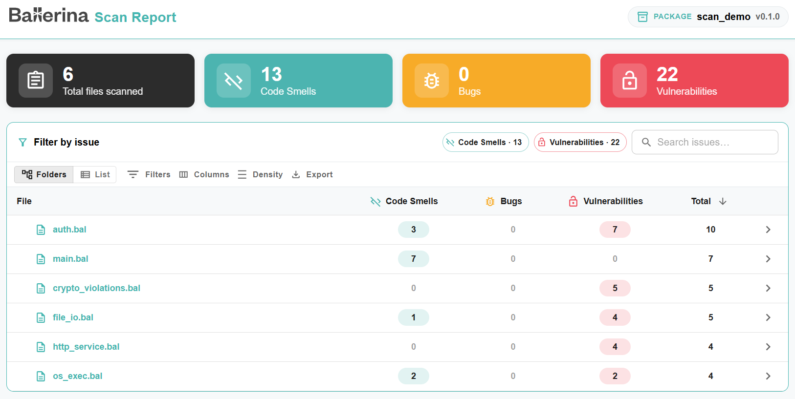
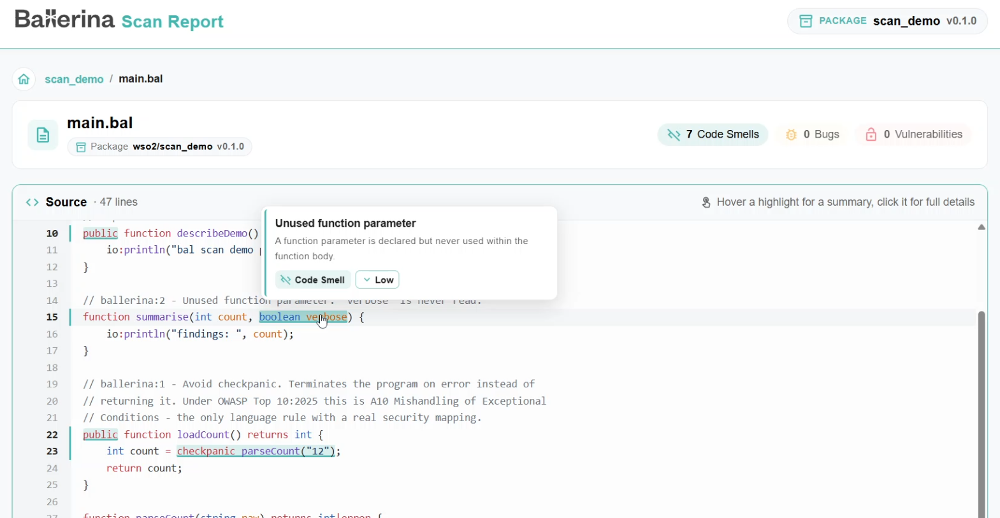
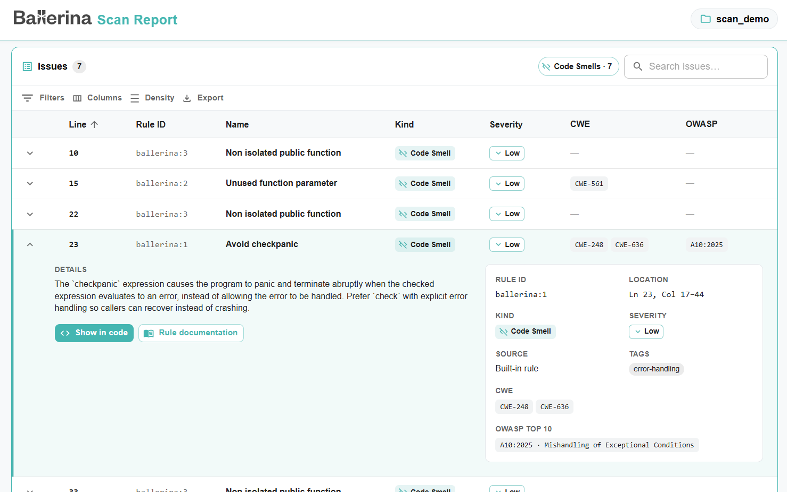

The Ballerina scan tool is a static code analysis tool that performs analysis on Ballerina projects and identifies
potential code smells, bugs, and vulnerabilities without executing them.

> **Note:** Ballerina scan is an experimental feature, and its rule set is small for two separate reasons. The tool itself is still growing, and the language already closes off several weakness classes that other static analysis tools must detect at scan time, because the compiler rejects them outright. See [Language guarantees](/learn/language-guarantees/) for what the compiler enforces.

This page shows how to install the tool, run a scan, and read its results.

## Install the tool

Execute the command below to pull the scan tool from [Ballerina Central](https://central.ballerina.io/ballerina/tool_scan/latest).

```
$ bal tool pull scan
```

This page describes the latest version of the scan tool, which is compatible with Ballerina 2201.13.2 (Swan Lake Update 13) and later. To update an earlier installation, run `bal tool update scan`.

To verify the installation and check the version:

```
$ bal tool list
```

For more information about managing Ballerina tools, refer to the [Ballerina CLI tool command documentation](https://ballerina.io/learn/cli-commands/#tool-commands).

## Run a scan

Run the following command inside a package directory:

```
$ bal scan
```

The output looks like this:

```
Running Scans

[
  {
    "location": {
      "filePath": "main.bal",
      "startLine": 23,
      ...
    },
    "rule": {
      "id": "ballerina:1",
      "name": "Avoid checkpanic",
      "severity": "LOW",
      ...
    },
    ...
  }
]

1 issue(s)

View scan results at:
	file:///home/user/bal-scan-demo/target/report/scan_results.json
```

The scan compiles and analyzes every `.bal` file in the package, prints the issues it finds, and saves them to
`target/report/scan_results.json`. Only the issues are written to standard output, so `bal scan > issues.json` saves
valid JSON, unless a platform plugin starts a process that inherits standard output and prints to it. Everything else,
such as progress messages, warnings, the issue summary, the report path, and anything printed by compiler plugins or
platform plugins, is written to standard error. For every option the command accepts, see
[Command syntax and options](/learn/scan-tool-configuration/#command-syntax-and-options).

The scan exits with code `0` even when it finds issues. To make it fail on findings, for example, to stop a CI
pipeline on `HIGH` issues, see [Fail the scan on findings](/learn/scan-tool-configuration/#fail-the-scan-on-findings).

To accept an issue in the source instead of fixing it, add a `@scan:Suppress` annotation with the reason. Suppressed
issues are left out of the printed results and counted separately in the summary, such as
`3 issue(s), 2 suppressed`. See [Suppress issues](/learn/scan-tool-configuration/#suppress-issues).

### Details

- The saved report also contains the suppressed issues, each marked with a `suppressions` entry.
- `--list-rules` prints its rule table to standard output.
- When the scan fails before reporting, for example, on a compilation error, a missing `Dependencies.toml`, an unmet
  suppression requirement, or a platform that is not declared or cannot be loaded, no issues are printed and a
  redirected file can be empty. The exit code alone does not show whether results were written: a tripped gate, or a
  platform that fails while it receives the results, also exits with code `1`, but only after the results are printed
  and saved. See [Exit codes](/learn/scan-tool-configuration/#exit-codes).

## Choose what to scan

By default, `bal scan` analyzes the package in the current directory. To analyze another package, pass its path:

```
$ bal scan mypackage
```

The test sources of the package are scanned too. To leave them out, see
[Exclude test sources](/learn/scan-tool-configuration/#exclude-test-sources).

To analyze a standalone Ballerina file, pass the file name:

```
$ bal scan myfile.bal
```

A file that is part of a package cannot be analyzed on its own. Analyze the whole package instead.

To analyze a workspace, run `bal scan` in the workspace root or pass its path. The scan resolves the workspace
dependencies and analyzes each package in dependency order. The issues of every package are printed as one document,
and empty packages are skipped with a warning.

### Dependency resolution

The scan uses the dependency versions locked in `Dependencies.toml` and does not update the file. A package without
`Dependencies.toml` cannot be scanned, in the command line or the editor, and its rules are not listed either: the scan
fails with exit code `1`. Run `bal build` first to lock its dependencies.

> **Note:** In a workspace, each package needs its own `Dependencies.toml`, and one unlocked package fails the whole
> run.

The exception is the analyzers in the `[[analyzer]]` table of `Scan.toml`: they are not dependencies of the package, so
the scan resolves them itself. See [Settings only in Scan.toml](/learn/scan-tool-configuration/#settings-only-in-scantoml).

## Generate reports

Every `bal scan` run on a package or workspace saves its results to the `report` folder of the target directory, which
is `target/report` by default. When a platform runs the scan itself, such as SonarQube during a SonarScanner analysis,
the results are not saved there. See [Platform integration](/learn/scan-tool-integration/#details).

### Report formats

The results are saved in JSON by default, to `scan_results.json`. Each finding is reported with its location, the
details of the rule that raised it, and other useful information:

```json
[
  {
    "location": {
      "filePath": "main.bal",
      "startLine": 23,
      "endLine": 23,
      "startColumn": 17,
      "endColumn": 44,
      "startOffset": 875,
      "length": 27,
      "snippet": "checkpanic parseCount(\"12\")"
    },
    "rule": {
      "id": "ballerina:1",
      "numericId": 1,
      "name": "Avoid checkpanic",
      "description": "Using `checkpanic` lets an unhandled error panic and crash the program instead of being handled.",
      "details": "The `checkpanic` expression causes the program to panic and terminate abruptly when the checked expression evaluates to an error, instead of allowing the error to be handled. Prefer `check` with explicit error handling so callers can recover instead of crashing.",
      "helpUri": "https://ballerina.io/learn/scan-rules/#ballerina-1",
      "severity": "LOW",
      "tags": [
        "error-handling"
      ],
      "standards": {
        "cwe": [
          248,
          636
        ],
        "owasp": [
          {
            "year": 2025,
            "categories": [
              10
            ]
          }
        ]
      },
      "ruleKind": "CODE_SMELL"
    },
    "source": "BUILT_IN",
    "fileName": "main.bal",
    "filePath": "/home/user/bal-scan-demo/main.bal"
  }
]
```

The `location` gives one-based lines and columns, as the compiler diagnostics and the SARIF report do. Its `filePath`
is the path of the file relative to the package root, such as `modules/db/db.bal`, or to the workspace root in the
output and combined report of a workspace scan. The `scan_results.json` of each workspace package gives paths relative
to the root of that package, and a single Ballerina file gives its file name. The top-level `filePath` is the path of
the file as the scan loaded it.

> **Note:** This is a breaking change in versions 0.14.0 and 0.11.2: earlier versions gave zero-based lines and columns
> and only the file name in the `location`. Consumers that added one to the lines or columns, or matched files by name,
> must be updated.

To use SARIF, a standardized format for static analysis results, use the `--format` option. The results are then
printed in SARIF and saved to `scan_results.sarif`:

```
$ bal scan --format=sarif
```

### HTML report

To also generate a detailed HTML report, use the `--scan-report` option:

```
$ bal scan --scan-report
```

The HTML report includes a summary of the total number of files scanned and the number of code smells, bugs, and
vulnerabilities found in each file. You can filter, search, and export the list of files.



To investigate further, click on a file name to open the file view. This view shows the source of the file and
highlights the exact lines where problems were detected. Hover over a highlight to see a summary of the issue, or click
it to see the full details.



The issues found in the file are listed in a table with the line, rule ID, name, kind, severity, CWE, and OWASP Top 10
category of each issue. Expand an issue to see its description and the full rule details, such as its location, source,
and tags. From there, you can jump to the issue in the source using **Show in code**, or open the rule's documentation
using **Rule documentation**.



### Custom target directory

To store the reports in another location, for example, when you work with multiple projects, use the `--target-dir`
option. The reports are written to the `report` folder inside this directory:

```
$ bal scan --target-dir="path/to/your/target/directory"
```

### Details

- A relative `--target-dir` is resolved against the package or workspace root, not the current working directory.
- The reports are generated even when the results are also reported to a platform such as SonarQube. See
  [Integrate the scan tool](/learn/scan-tool-integration/).
- Reports are only saved for Ballerina packages and workspaces. For a standalone Ballerina file, `--scan-report` and
  `--target-dir` are ignored with a warning.

## List rules

To view the rules available to your project, use the `--list-rules` option:

```
$ bal scan --list-rules
```

The output looks like this:

```
Resolving scan rules from package dependencies
	RuleID       | Rule Kind     | Severity | Rule Description
	-----------------------------------------------------------------------------------------
	ballerina:1  | CODE_SMELL    | LOW      | Avoid checkpanic
	ballerina:2  | CODE_SMELL    | LOW      | Unused function parameter
	...
	ballerina:13 | VULNERABILITY | HIGH     | Hard-coded secrets are security-sensitive
	ballerina:14 | VULNERABILITY | MEDIUM   | Non configurable secrets are security-sensitive
	...
```

The list contains the core rules, the rules contributed by the project's direct dependencies (library tools and static
code analyzer plugins, but not transitive dependencies), and the rules of the analyzers in the `[[analyzer]]` table of
`Scan.toml`, so it differs from project to project. For a single Ballerina file, such as
`bal scan main.bal --list-rules`, the core rules are listed, along with the rules of any imported module that provides
a scan-enabled compiler plugin.

For detailed explanations of each rule, with noncompliant and compliant code examples, see [Scan rules](/learn/scan-rules/).
To run only some of these rules, or to skip the ones that don't apply to your project, use `--include-rules` or
`--exclude-rules`. See [Include and exclude rules](/learn/scan-tool-configuration/#include-and-exclude-rules). To
apply the same selection, and other settings such as the gate, to every run, save them in `Scan.toml`. See
[Share settings in Scan.toml](/learn/scan-tool-configuration/#share-settings-in-scantoml).

## Rule severity

Every rule has a `severity` that indicates how urgently a reported issue should be addressed, and how it can affect
development and deployment if left unresolved:

| Severity | Meaning | Impact |
|---|---|---|
| `BLOCKER` | A critical issue that is very likely to cause application failure or a security breach. | Should block merging or deployment until fixed. |
| `HIGH` | A serious issue likely to cause incorrect behavior or expose the application to exploitation. | Should be fixed before deployment. |
| `MEDIUM` | An issue that affects reliability, maintainability, or security to a moderate degree. | Should be scheduled and fixed soon, does not need to block deployment on its own. |
| `LOW` | A minor issue such as a code smell that affects readability or maintainability. | Safe to defer, but worth cleaning up over time. |
| `INFO` | An informational finding with no material severity. | Does not require action; useful for awareness. |

Where applicable, a rule is also mapped to its relevant CWE and OWASP Top 10 coverage. See
[Security standards mapping](/learn/scan-rules/#security-standards-mapping).

To fail the scan when issues at or above a severity are found, see
[Fail the scan on findings](/learn/scan-tool-configuration/#fail-the-scan-on-findings).
